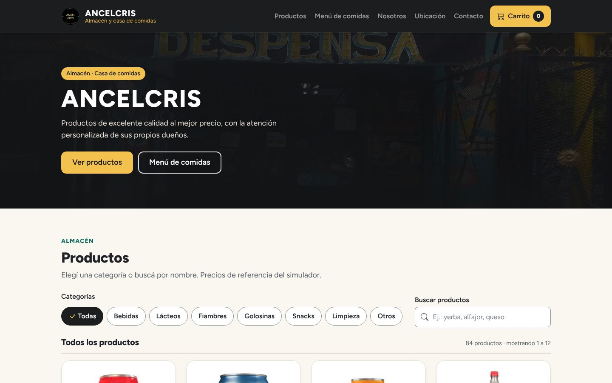
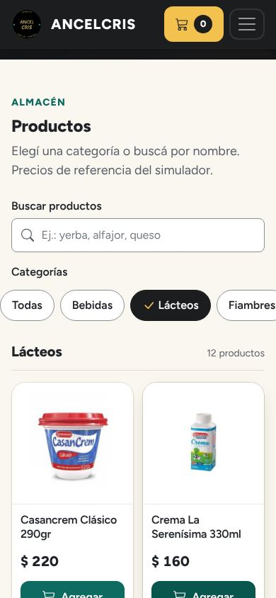
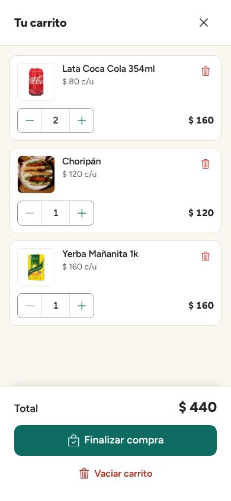
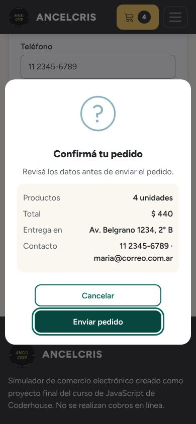
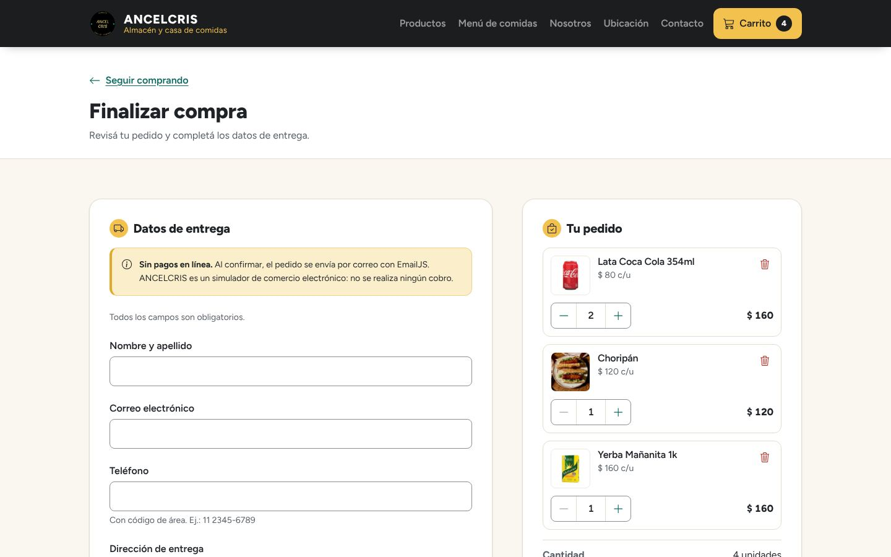
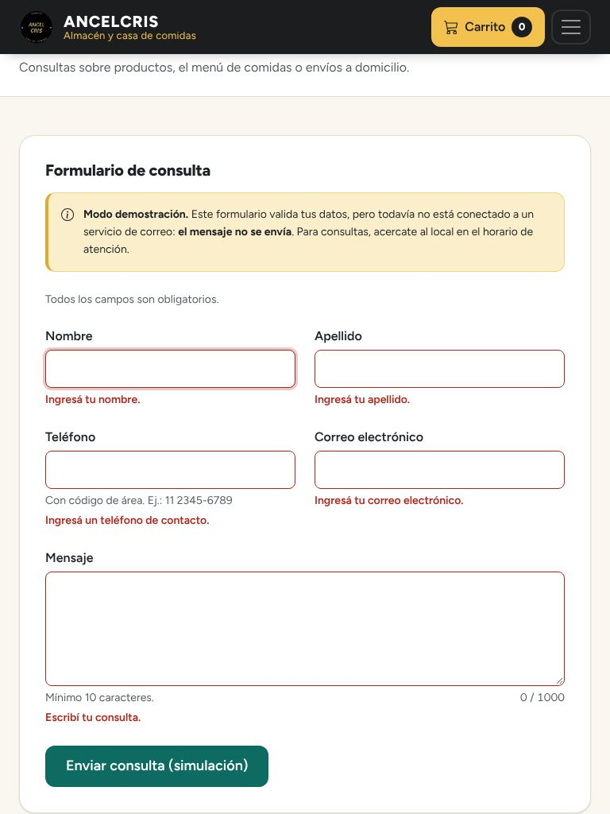

# ANCELCRIS · Almacén y casa de comidas

Simulador de comercio electrónico para **ANCELCRIS**, el almacén y casa de comidas de la familia
Ovejero. Es el proyecto final del curso de JavaScript de Coderhouse: un catálogo con categorías,
búsqueda y paginación, un menú de comidas, un carrito persistente y los formularios de compra y
de contacto, hecho con HTML, CSS, JavaScript sin frameworks, Bootstrap y SweetAlert2.

[Ver la demo publicada en GitHub Pages](https://cristian1891.github.io/E-commerce-Proyecto-Final/)
(muestra la versión de la rama publicada; los cambios de esta rama se ven allí después de integrarlos).



## Índice

1. [Contexto](#contexto)
2. [Funcionalidades](#funcionalidades)
3. [Tecnologías y versiones](#tecnologías-y-versiones)
4. [Instalación y ejecución](#instalación-y-ejecución)
5. [Estructura del proyecto](#estructura-del-proyecto)
6. [Modelo de productos y carga con fetch](#modelo-de-productos-y-carga-con-fetch)
7. [Carrito y persistencia](#carrito-y-persistencia)
8. [Formularios y servicios externos](#formularios-y-servicios-externos)
9. [Decisiones de UX/UI, accesibilidad y rendimiento](#decisiones-de-uxui-accesibilidad-y-rendimiento)
10. [Requisitos de Coderhouse](#requisitos-de-coderhouse)
11. [Pruebas, limitaciones y pendientes](#pruebas-limitaciones-y-pendientes)
12. [Capturas](#capturas)
13. [Autor, créditos y licencias](#autor-créditos-y-licencias)

## Contexto

ANCELCRIS es un comercio de venta al por menor atendido por sus propios dueños, con más de 20 años
en la actividad, que además funciona como casa de comidas. El proyecto muestra cómo podría
funcionar una tienda en línea para el negocio: consultar productos y platos desde el celular,
armar un pedido y enviarlo.

Es un **simulador**: no hay pagos en línea, los precios son valores de referencia del conjunto de
datos original y el stock no se controla.

## Funcionalidades

- **Catálogo** de 84 productos en 7 categorías, cargados con `fetch` desde archivos JSON.
- **Categorías** como botones con estado activo (`aria-pressed`), incluida la opción "Todas".
- **Búsqueda por nombre** que ignora tildes y mayúsculas ("serenisima" encuentra "Serenísima") y se
  combina con la categoría elegida y con la paginación.
- **Paginación** de 12 productos por página con "Anterior / Siguiente", números de página e
  indicador "Página X de Y".
- **Estados** de carga, categoría vacía, búsqueda sin resultados (con "Limpiar búsqueda" y "Buscar
  en todas las categorías") y error de red con botón **Reintentar**.
- **Menú de comidas** (9 platos) que se suma al mismo carrito.
- **Carrito** en un panel lateral (offcanvas de Bootstrap): cambiar cantidades, quitar, vaciar con
  confirmación, subtotales y total siempre sincronizados, contador en el encabezado y persistencia
  en `localStorage`.
- **Página de compra** con resumen editable del pedido, formulario de entrega con validación junto a
  cada campo, diálogo de confirmación con el resumen y envío por EmailJS.
- **Página de contacto** con formulario validado que funciona en **modo simulación** y lo informa.
- **Notificaciones** de SweetAlert2 con el estilo del sitio.
- Dirección, horarios y mapa del local.

## Tecnologías y versiones

Todas las bibliotecas se sirven localmente desde el repositorio (no hay proceso de compilación).

| Recurso | Versión | Uso | Ubicación |
| --- | --- | --- | --- |
| HTML, CSS y JavaScript | Módulos ES (`type="module"`) | Estructura, estilos y lógica | `index.html`, `paginas/`, `css/`, `js/` |
| Bootstrap | 5.1.3 | Grilla, navegación colapsable, offcanvas, botones y formularios | `lib/bootstrap/` |
| SweetAlert2 | 11.26.25 | Notificaciones breves y diálogos | `lib/sweetalert2/` |
| Figtree | Variable, subconjunto latino (Fontsource 5.3.0) | Tipografía del sitio | `fuentes/figtree/` |
| Bootstrap Icons | 1.13.2 (27 íconos) | Sprite SVG de íconos | `img/iconos.svg` |
| EmailJS | API REST v1.0 | Envío del pedido por correo | `js/emailjs.js`, `js/config.js` |
| Google Maps | Mapa embebido | Ubicación del local | `index.html` |

**Cambios de dependencias respecto de la versión anterior**

- **SweetAlert2: 7.33.1 → 11.26.25.** El README anterior decía 11.1.9, pero el archivo local era
  la 7.33.1 y el código usaba la opción `type`, propia de v7. Se actualizó a la v11 para usar la
  API vigente (`icon`, `customClass` por partes, `Swal.mixin`, `titleText`, `target`) y sus
  variables CSS para integrarla al diseño. Se revisaron todos los usos (toasts, confirmaciones y
  mensajes) sin advertencias en consola. Algunas versiones 11.x (por ejemplo, la 11.4.9) incluyen
  código que cambia el comportamiento según el idioma y el dominio del sitio; se verificó que el
  archivo distribuido de la 11.26.25 no lo contiene.
- **Bootstrap 5.1.3 se conserva.** Se comparó con la distribución oficial: el JavaScript es
  idéntico y el CSS difiere solo en un espacio no separable dentro de un `content`. Se quitó `popper.min.js`, que se cargaba aparte aunque `bootstrap.bundle.min.js` ya lo
  incluye.
- **Se quitaron** Normalize 8.0.1 (Bootstrap ya incluye Reboot y Normalize se cargaba después,
  pisándolo), Animate.css 4.1.1 (72 KB para un solo efecto, reemplazado por animaciones CSS
  propias), el kit remoto de Font Awesome 5.15.4 (reemplazado por un sprite SVG local) y la carga
  de Roboto desde Google Fonts con `@import` (reemplazada por Figtree alojada localmente).

## Instalación y ejecución

El sitio es estático, pero **necesita un servidor HTTP**: `fetch` y los módulos de JavaScript no
funcionan abriendo el archivo con doble clic (`file://`).

```bash
git clone https://github.com/Cristian1891/E-commerce-Proyecto-Final.git
```

```bash
cd E-commerce-Proyecto-Final
```

Opción A, con Python 3:

```bash
python3 -m http.server 8000
```

y abrir <http://localhost:8000/>.

Opción B, con Visual Studio Code: instalar la extensión **Live Server**, abrir la carpeta y elegir
"Open with Live Server" sobre `index.html`.

Para publicarlo en **GitHub Pages** no hace falta nada más: todas las rutas son relativas y el
JavaScript calcula la raíz del sitio a partir de la ubicación de sus propios archivos, así que
funciona también dentro de `/E-commerce-Proyecto-Final/`.

## Estructura del proyecto

```text
├── index.html               Inicio: portada, catálogo, menú, nosotros, envíos y ubicación
├── paginas/
│   ├── compra.html          Resumen del pedido y datos de entrega
│   └── contacto.html        Formulario de consulta y datos del local
├── css/estilos.css          Sistema visual y personalización de Bootstrap y SweetAlert2
├── js/
│   ├── main.js              Catálogo (categorías, búsqueda, paginación), menú y botones "Agregar"
│   ├── carrito.js           Clase Carrito: datos, reglas y localStorage (sin DOM)
│   ├── carrito-vista.js     Contador, panel del carrito y resumen de compra
│   ├── compra.js            Validación y envío del pedido
│   ├── contacto.js          Validación y simulación (o envío) del formulario de contacto
│   ├── validaciones.js      Reglas de validación y errores junto a cada campo
│   ├── emailjs.js           Envío con la API REST de EmailJS (fetch + AbortController)
│   ├── config.js            Configuración de EmailJS
│   ├── alertas.js           Configuración centralizada de SweetAlert2
│   ├── interfaz.js          Menú móvil y año del pie
│   └── utilidades.js        Rutas, formato de moneda, escape de HTML, fetch de JSON
├── data/*.json              Catálogos: bebidas, lacteos, fiambres, golosinas, snacks, limpieza, otros, menu
├── img/
│   ├── <categoria>/         Fotos de productos (300 × 300)
│   ├── optimizadas/         Portada, nosotros, envíos y logo en WebP/JPEG responsive
│   └── iconos.svg           Sprite de íconos
├── fuentes/figtree/         Fuente Figtree (WOFF2) y su licencia OFL
├── lib/                     Bootstrap y SweetAlert2 (sin modificar) con sus licencias
├── docs/
│   ├── capturas/            Capturas reales usadas en este README
│   └── prompts-imagenes.md  Prompts y criterios para futuros recursos fotográficos
└── prototype/               Prototipos de diseño originales
```

## Modelo de productos y carga con fetch

Cada archivo de `data/` es un array de objetos con esta forma:

```json
{ "id": 13, "nombre": "Casancrem Clásico 290gr", "precio": 220, "img": "casancrem.jpg", "categoria": "lacteos" }
```

- `id` es único en todo el catálogo (1 a 93) y es la clave del carrito.
- `categoria` es un **identificador interno** que coincide con el nombre del archivo JSON y con la
  carpeta de imágenes (`img/lacteos/casancrem.jpg`). La etiqueta visible está separada en el objeto
  `CATEGORIAS` de `js/main.js`: por eso se muestra "Lácteos" con tilde sin romper la ruta
  `data/lacteos.json`.
- `precio` es un número: todos los cálculos parten de este valor y nunca de un texto formateado.
  Los importes se muestran con `Intl.NumberFormat('es-AR', { style: 'currency', currency: 'ARS' })`.

Flujo de carga (`js/main.js`):

1. `obtenerJSON()` hace el `fetch`, valida `response.ok` (fetch no rechaza ante un 404 o un 500) y
   devuelve el JSON.
2. `cargarCategoria()` guarda la **promesa** de cada categoría en un `Map` para no descargarla dos
   veces. "Todas" combina las siete categorías con `Promise.all`. Si una carga falla, se borra del
   caché para que "Reintentar" vuelva a pedirla.
3. `mostrarCatalogo()` numera cada pedido: si el usuario cambia de categoría antes de que llegue una
   respuesta lenta, esa respuesta desactualizada se descarta.
4. Los productos se validan (`validarProductos`) y se filtran, paginan y dibujan con `filter`,
   `slice` y `map`. Todo texto del JSON se escapa antes de insertarse en el DOM.

En esta versión se corrigieron nombres en los JSON (tildes y marcas: "La Serenísima", "Hellmann's",
"Marlboro", "Tortilla de papa", etc.) y se distinguieron dos quesos que tenían el mismo nombre
según la variedad impresa en su foto (Sardo y Danbo). No se cambiaron ids, precios ni imágenes.

## Carrito y persistencia

- **Agregar un producto que ya está en el carrito suma una unidad**, como pasa en un almacén. La
  notificación lo indica ("Sumaste otra unidad… (2 en el carrito)") y la tarjeta muestra
  "En el carrito: 2".
- Las cantidades son **enteros de 1 a 20**. Lo que se escribe a mano se corrige (25 → 20,
  0 → 1, 2.7 → 2) y se avisa. El botón "−" se deshabilita en 1 y "+" en 20; para eliminar se usa
  el botón **Quitar**.
- **Vaciar** pide confirmación y elimina **solo** la clave `ancelcris:carrito` de `localStorage`
  (no se usa `localStorage.clear()`).
- Al leer el carrito guardado se **validan** los datos: se descartan registros dañados, se unifican
  productos repetidos y se corrigen cantidades. Si `localStorage` no está disponible, el carrito
  funciona en memoria y se avisa que se perderá al recargar.
- Si el carrito cambia en otra pestaña, la página abierta se actualiza (evento `storage`).
- La misma vista (`js/carrito-vista.js`) atiende el panel lateral del inicio y de contacto y el
  resumen de la página de compra, mediante delegación de eventos y `closest()`. Después de cada
  cambio devuelve el foco al control que se estaba usando.

## Formularios y servicios externos

### Compra (EmailJS)

El formulario se maneja desde el evento `submit`. Valida los campos y muestra los errores **junto a
cada campo** sin borrar lo escrito, lleva el foco al primer error y, si todo está bien, abre un
diálogo con el resumen (unidades, total, dirección y contacto) para confirmar. Durante el envío el
botón muestra "Enviando pedido…" y se deshabilita para evitar envíos duplicados.

Se conserva la integración original con la API REST de EmailJS: servicio `default_service`,
plantilla `template_hq87b19` y los parámetros `destinatario`, `email`, `total` y `direccion`. Ahora
también se envían `telefono` y `detalle` (lista de productos) por si se quieren usar en la plantilla.

- Si EmailJS responde bien, se muestra "¡Pedido enviado!", se aclara que no hubo cobro y se vacía el
  carrito.
- Si falla (error HTTP, red caída o más de 15 segundos), se muestra un error recuperable: el carrito
  y los datos se conservan para reintentar.
- **No se pudo verificar si las credenciales de EmailJS siguen activas:** comprobarlo implicaba
  enviar un correo real, y en las pruebas EmailJS se interceptó.

### Contacto (simulación)

El formulario original solo mostraba "Formulario enviado" sin enviar nada. Ahora funciona en
**modo simulación explícito**: un aviso lo dice antes de completar, el botón dice "Enviar consulta
(simulación)" y, al validar, el diálogo informa que **el mensaje no se envió**. No hay demoras
artificiales y lo escrito queda en el formulario.

### Cómo configurar EmailJS

1. Crear una cuenta en [EmailJS](https://www.emailjs.com/) y conectar un servicio de correo.
2. Crear una plantilla. Para contacto se envían `nombre`, `apellido`, `telefono`, `email` y
   `mensaje`.
3. Copiar la clave pública (*Public Key*), el id del servicio y el de la plantilla en
   `js/config.js`:

   ```js
   plantillas: {
       compra: 'template_hq87b19',
       contacto: 'template_xxxxxxx', // vacío ('') = modo simulación
   },
   ```

4. En el panel de EmailJS conviene limitar los dominios permitidos al de GitHub Pages.

Si una plantilla queda vacía, ese formulario pasa automáticamente a modo simulación y lo indica en
pantalla.

## Decisiones de UX/UI, accesibilidad y rendimiento

### Dirección visual

Almacén familiar argentino: cercano, ordenado y confiable. La paleta sale del logotipo (carbón,
mostaza y el verde azulado de sus puntos), con fondo crema y superficies blancas para que las
fotos de productos se lean bien.

| Uso | Color | Contraste medido |
| --- | --- | --- |
| Texto sobre fondo crema | `#1f2328` / `#faf7f0` | 14,8:1 |
| Texto secundario | `#575e66` / `#faf7f0` | 6,1:1 |
| Botón principal (texto blanco) | `#0d6b61` | 6,4:1 |
| Acento mostaza (texto carbón) | `#f2c14e` / `#1c1d1f` | 10,1:1 |
| Acción destructiva | `#b42318` / blanco | 6,6:1 |
| Borde de campos (componente) | `#8a8f96` / blanco | 3,3:1 |

- **Sistema** en variables CSS (`:root` de `css/estilos.css`): colores, escala tipográfica con
  `clamp()`, espaciado de 4 px, anchos máximos (1200 px de contenido, 65 caracteres de texto),
  radios y sombras.
- **Botones:** principal (verde azulado), acento (mostaza), secundario con contorno y destructivo
  en texto rojo; con estados hover, foco, activo, deshabilitado y carga (spinner).
- **Tipografía:** Figtree, un único archivo variable WOFF2 de 20 KB precargado, con
  `font-display: swap` y pila de respaldo del sistema. Se usan los pesos 400, 600 y 800; un solo
  archivo variable pesa menos que tres estáticos. Ya no se usan cursivas para el texto general.
- **Portada compacta** (unos 415 px de alto) con dos accesos directos: el título del catálogo
  aparece dentro de la primera pantalla en los tamaños probados (360 × 780, 390 × 844, 768 × 1024
  y 1440 × 900). El carrusel anterior usaba el atributo de
  Bootstrap 4 `data-ride`, por eso nunca rotaba.
- **Navegación:** encabezado fijo con el carrito siempre visible (también en móvil, fuera del menú
  colapsable). Se verificó que el encabezado ocupa una sola fila de 320 a 1440 px.
- **Bootstrap** se personaliza con reglas propias cargadas después de sus estilos, sin modificar
  sus archivos. El único `!important` propio está en el bloque de movimiento reducido.
- **SweetAlert2** se configura en `js/alertas.js` con dos `Swal.mixin`: notificaciones breves que
  no interrumpen ni toman el foco, y diálogos solo para decisiones (vaciar, confirmar pedido) o
  resultados importantes. Usan los botones de Bootstrap (`buttonsStyling: false`) y las variables
  CSS de la v11 con la paleta del sitio.

### Accesibilidad

Se tomó WCAG 2.2 AA como referencia; **no se declara conformidad completa** porque no se hizo una
evaluación manual integral (ver [pendientes](#pruebas-limitaciones-y-pendientes)).

- HTML semántico en español (`lang="es"`), jerarquía de encabezados, regiones con nombre y enlace
  para saltar al contenido.
- Botones para acciones y enlaces para navegar. Nombres accesibles completos ("Agregar Choripán al
  carrito", "Quitar Choripán del carrito", "Carrito (3 productos)").
- Foco visible y consistente. Al paginar, el foco pasa al título de resultados; en el carrito,
  vuelve al control que se estaba usando.
- Anuncios para lectores de pantalla (`aria-live`) del conteo de resultados, los cambios del
  carrito y los errores de los formularios.
- Formularios con etiquetas visibles, ayudas, `autocomplete`, `aria-invalid` y `aria-describedby`
  hacia el mensaje de error. Las validaciones aceptan tildes, ñ, ü, apóstrofos, guiones y
  direcciones como "Av. Belgrano 1234, 2° B", "Calle 5 e/ 6 y 7" o "Los Aromos s/n".
- Imágenes de producto con `alt=""`, porque el nombre está justo al lado y se evita la repetición;
  la foto descriptiva de "Sobre nosotros" sí tiene texto alternativo.
- Objetivos táctiles de 44 px como mínimo en botones principales.
- `prefers-reduced-motion` anula animaciones y transiciones, incluidas las de Bootstrap y
  SweetAlert2.
- Los diálogos que se abren con el panel del carrito visible se montan dentro del panel: así el
  bloqueo de foco de Bootstrap no impide usarlos con teclado (problema detectado en las pruebas).

### Rendimiento

- Fotos grandes convertidas a WebP con variantes responsive (`srcset`/`sizes`) y respaldo JPEG:
  la portada pasó de 611 KB (JPEG de 1920 px) a entre 12 y 88 KB según el ancho y la densidad de
  la pantalla.
- Se reemplazaron los GIF de carga y "enviado" (714 KB y 964 KB) por un spinner de Bootstrap y
  los diálogos de SweetAlert2.
- Dimensiones explícitas en todas las imágenes, `fetchpriority="high"` en la portada y
  `loading="lazy"` en las imágenes que no están en la primera pantalla y en el mapa.
- Hojas de estilo en el orden correcto (bibliotecas y luego estilos propios), sin `@import`
  bloqueante y sin dependencias redundantes.
- Animaciones breves basadas en `opacity` y `transform`. El indicador de carga aparece con 300 ms
  de espera para no parpadear cuando el JSON llega rápido; no se retrasa el contenido.

Medición local (Chromium con Playwright, servidor sin compresión, carga inicial de `index.html` sin
desplazarse, servicios de terceros bloqueados en ambos casos):

| Versión | Ancho | Bytes del propio sitio | De ellos, imágenes |
| --- | --- | --- | --- |
| Anterior | 360 px | 2.449 KB | 2.013 KB |
| Nueva | 360 px | 686–931 KB* | 229–474 KB* |
| Anterior | 1440 px | 2.449 KB | 2.013 KB |
| Nueva | 1440 px | 1.035 KB | 578 KB |

\* Varía entre ejecuciones según cuántas imágenes diferidas decide adelantar el navegador. En
GitHub Pages los archivos de texto se sirven comprimidos, por lo que el peso transferido es menor.
No se hicieron mediciones con Lighthouse ni en una red real.

## Requisitos de Coderhouse

| Requisito | Dónde se demuestra |
| --- | --- |
| Objetos y arrays | Objeto `CATEGORIAS` y estado en [`js/main.js`](js/main.js#L13-L25); clase `Carrito` con array de ítems en [`js/carrito.js`](js/carrito.js#L59) |
| Métodos de arrays | `filter`, `map`, `slice` en [`js/main.js`](js/main.js#L214-L235); `reduce` para totales en [`js/carrito.js`](js/carrito.js#L163-L169); `find` y `filter` en el carrito |
| Funciones, condicionales e iteradores | [`validarProductos`](js/main.js#L48), [`limitarCantidad`](js/carrito.js#L11), `for…of` en [`sanear`](js/carrito.js#L33), validaciones en [`js/validaciones.js`](js/validaciones.js) |
| Generación dinámica del DOM | [`plantillaTarjeta`](js/main.js#L81), [`renderizarPaginacion`](js/main.js#L170), [`plantillaItem`](js/carrito-vista.js#L9) |
| Eventos e interacción | [`registrarEventos`](js/main.js#L305) con delegación y `closest()`; eventos `click` y `change` del carrito en [`js/carrito-vista.js`](js/carrito-vista.js#L101-L130); `submit` en [`js/compra.js`](js/compra.js#L140) |
| Sintaxis avanzada | Desestructuración, parámetros por defecto, spread, encadenamiento opcional (`?.`), `??`, módulos ES, clases con getters y `import.meta.url` en [`js/utilidades.js`](js/utilidades.js#L6) |
| Uso relevante de librerías | Bootstrap (offcanvas, collapse, grilla y formularios) y SweetAlert2 centralizado en [`js/alertas.js`](js/alertas.js#L20-L69) |
| Promesas con fetch | [`obtenerJSON`](js/utilidades.js#L37) con validación de `response.ok`; `Promise.all` en [`cargarCategoria`](js/main.js#L61); `async/await` con `try/catch` y `AbortController` en [`js/emailjs.js`](js/emailjs.js#L7) |
| Datos desde JSON local o API | Catálogos de [`data/`](data/) cargados con fetch; envío a la API de EmailJS |
| Persistencia | `localStorage` validado en [`js/carrito.js`](js/carrito.js#L48-L94) |

## Pruebas, limitaciones y pendientes

### Pruebas realizadas

Se hicieron con herramientas externas al proyecto (Playwright con Chromium y axe-core 4.14.0),
sirviendo el sitio con `python3 -m http.server`. **EmailJS se interceptó en todas las pruebas: no
se envió ningún correo.** Los scripts de prueba no forman parte del repositorio ni son un
requisito para ejecutarlo.

- **23 escenarios funcionales, todos aprobados**, tanto en la raíz del servidor como dentro de una
  subcarpeta que imita GitHub Pages (sin ningún 404):
  - carga de los JSON y de todas las imágenes; categorías, búsqueda (con y sin tildes), búsqueda
    sin resultados, paginación y foco;
  - cambios rápidos de categoría con respuestas lentas (se ignora la desactualizada);
  - error 500 y fallo de red en catálogo y menú, con reintento;
  - agregar, repetir, máximo de 20, cambiar cantidades a mano y con botones, quitar, vaciar con
    confirmación y cancelación, borrado solo de la clave del carrito, persistencia al recargar y
    datos dañados en `localStorage` (incluido un intento de inyección de HTML);
  - compra con carrito vacío, totales sincronizados, errores de validación junto a cada campo,
    conservación de lo escrito, confirmación y cancelación, envío exitoso, error HTTP 400 y error
    de red recuperables, y prevención de envío duplicado;
  - contacto en modo simulación sin peticiones de red;
  - teclado: enlace de salto, orden del encabezado, apertura y cierre del carrito con Escape y
    retorno del foco, categorías con la barra espaciadora y foco visible;
  - movimiento reducido.
- **axe-core** (reglas WCAG 2.0, 2.1 y 2.2 A/AA y buenas prácticas) en 7 estados × 2 anchos
  (inicio, carrito abierto, diálogo de vaciar, búsqueda sin resultados, compra con errores, compra
  vacía y contacto con errores): **0 violaciones**. Quedan para revisión manual el contraste del
  texto sobre la foto de portada (axe no puede calcularlo sobre imágenes) y el contenido del mapa
  de Google.
- **Diseño responsive:** sin desborde horizontal ni errores de consola en 360, 390, 768, 1024 y
  1440 px, y encabezado en una sola fila en todos los anchos de 320 a 1440 px (cada 10 px).
- **Consola:** sin errores ni advertencias de SweetAlert2 en los flujos de carrito, compra y
  contacto.

### Limitaciones y pendientes

- No se probó con lectores de pantalla (NVDA, VoiceOver, TalkBack), ni en Firefox o Safari, ni en
  dispositivos reales: solo Chromium automatizado.
- El mapa de Google no se pudo cargar en el entorno de pruebas (red restringida).
- Las credenciales de EmailJS no se verificaron (ver [Formularios](#formularios-y-servicios-externos)).
- El formulario de contacto seguirá en simulación hasta que se configure una plantilla.
- Los precios son los del conjunto de datos original; no hay control de stock.
- "Lavandina Ayudín 55gr" probablemente tiene mal la unidad: queda para revisar con el almacén.
- `img/interior.jpg` (usada en "Sobre nosotros") y `img/envios.jpg` parecen fotos de banco de
  imágenes; conviene reemplazarlas por fotos reales del local (ver
  [`docs/prompts-imagenes.md`](docs/prompts-imagenes.md)). Esta sesión no tenía herramienta de
  generación de imágenes, así que no se crearon recursos nuevos.
- Hay recursos sin uso que se podrían borrar: `img/imgComp/` (de otro proyecto),
  `img/img responsive/`, `img/exterior.jpg`, `img/alimentos.jpg`, `img/bebidas.jpg`,
  `img/fiambres.jpg`, `img/limpieza.jpg`, `img/contacto.jpg`, `img/carrito.png` y `img/cargando.gif`
  / `img/mail.gif` (los GIF ya no se cargan).
- Las fotos de productos siguen en JPEG/PNG de 300 × 300 (entre 3 y 60 KB); podrían pasarse a WebP.
- El catálogo incluye cigarrillos. Si el sitio se usara como tienda real, conviene revisar la
  normativa vigente sobre venta y publicidad de productos de tabaco.

## Capturas

Capturas reales tomadas con Playwright sobre esta versión.

| Catálogo en móvil | Carrito en móvil | Confirmación del pedido |
| --- | --- | --- |
|  |  |  |





## Autor, créditos y licencias

**Autor:** Cristian Ovejero ([@Cristian1891](https://github.com/Cristian1891)), proyecto final del
curso de JavaScript de Coderhouse.

| Recurso | Licencia | Archivo de licencia |
| --- | --- | --- |
| Bootstrap 5.1.3 | MIT | [`lib/bootstrap/LICENSE`](lib/bootstrap/LICENSE) |
| SweetAlert2 11.26.25 | MIT | [`lib/sweetalert2/LICENSE`](lib/sweetalert2/LICENSE) |
| Bootstrap Icons 1.13.2 | MIT | [`img/iconos-LICENSE.txt`](img/iconos-LICENSE.txt) |
| Figtree (The Figtree Project Authors) | SIL Open Font License 1.1 | [`fuentes/figtree/OFL.txt`](fuentes/figtree/OFL.txt) |

- **Fotografías:** la foto de portada (`img/ancelcris.jpg`), las de productos, platos y secciones
  vienen del proyecto original; el repositorio no documenta su origen ni su licencia. Las marcas y
  envases pertenecen a sus respectivos dueños. Las variantes de `img/optimizadas/` se generaron a
  partir de esas fotos (recorte de tamaño y conversión a WebP/JPEG), sin cambiar su contenido.
- **Datos del local** (dirección, horarios y texto de "Sobre nosotros"): del proyecto original.
- **Licencia del proyecto:** el repositorio no incluye un archivo de licencia, por lo que no se
  otorga una licencia de uso para el código propio.
